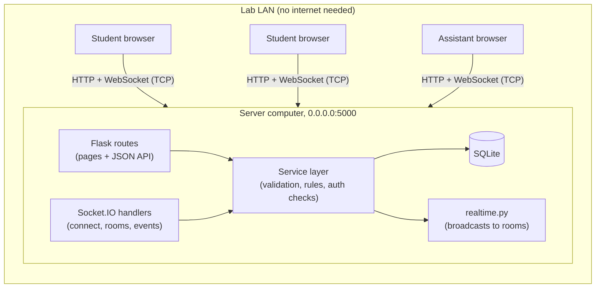
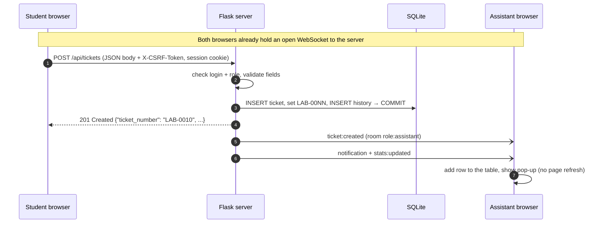
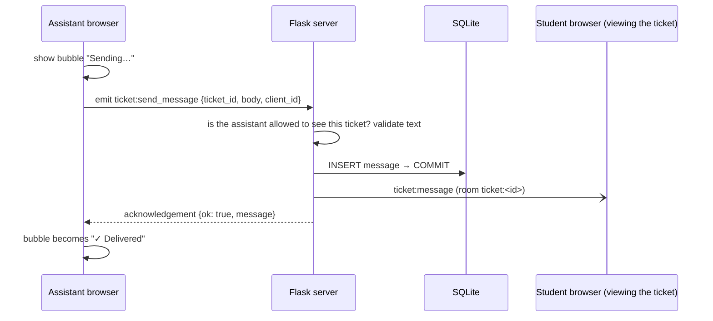
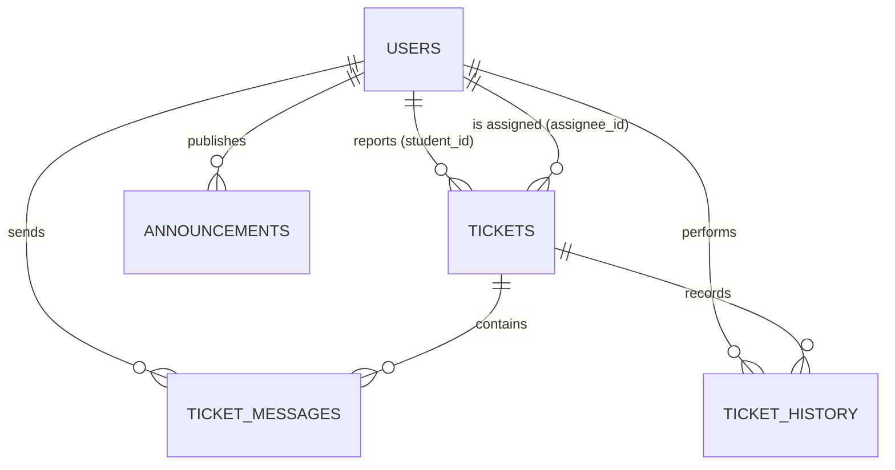

# Campus Lab Helpdesk

**Design and Implementation of an Offline LAN-Based Helpdesk and Communication System for Campus Computer Laboratories**

Computer Networks project · Python · Flask · Socket.IO (WebSocket over TCP) · SQLite

Students report problems with lab computers from their own workstation, chat with the lab
assistant and follow their ticket live. Lab assistants see new tickets appear instantly, take
ownership, update the status and broadcast announcements. Everything runs on **one computer in
the lab** and is used from other computers through a web browser over the **local network**. No
internet connection is needed.

---

## Contents

1. [Problem statement](#1-problem-statement)
2. [Features](#2-features)
3. [Technology stack](#3-technology-stack)
4. [Architecture](#4-architecture)
5. [Networking design](#5-networking-design)
6. [Database design](#6-database-design)
7. [Project structure](#7-project-structure)
8. [Installation on Ubuntu](#8-installation-on-ubuntu)
9. [Running the server and connecting from the LAN](#9-running-the-server-and-connecting-from-the-lan)
10. [Demo credentials](#10-demo-credentials)
11. [Live demonstration procedure](#11-live-demonstration-procedure)
12. [Running the tests](#12-running-the-tests)
13. [HTTP API reference](#13-http-api-reference)
14. [Socket.IO event reference](#14-socketio-event-reference)
15. [Security measures](#15-security-measures)
16. [Troubleshooting](#16-troubleshooting)
17. [Computer Networks concepts demonstrated](#17-computer-networks-concepts-demonstrated)
18. [Known limitations](#18-known-limitations)
19. [Viva questions and answers](#19-viva-questions-and-answers)

---

## 1. Problem statement

In a college computer laboratory students regularly run into problems such as a computer that will
not start, software that fails to open, no network connectivity, missing development tools, or broken
peripherals. Today the student has to leave their seat and look for the lab assistant, who has no
overview of which problems are waiting, how urgent they are, or who is already handling them.

This project provides a **LAN helpdesk**: a student submits a ticket from their workstation, the lab
assistant is notified in real time, and both sides communicate through the ticket until it is resolved.
Because labs often have limited or no internet access, the system must work with **only the local
network**.

## 2. Features

**Student portal**
- Dashboard with live counts (total, open, in progress, resolved), recent tickets and latest announcements.
- Report a problem: title, category (Hardware, Software, Network, Login/Access, Other), priority
  (Low, Medium, High, Critical), optional workstation number and description. The server assigns a
  unique ticket number (for example `LAB-0010`) and the submission time.
- My tickets: searchable, filterable table of the student's own tickets.
- Ticket detail: description, current status, assigned assistant, timeline of every status change,
  and a conversation with the assistant, all updated live.
- Announcements from the lab staff, pushed live.

**Lab assistant console**
- Overview: total, open, in-progress, resolved and high-priority-unresolved counts, number of live
  connections, a "Needs attention" queue of unassigned tickets and a live activity feed.
- Ticket management: search by ticket number, title or student; filter by status, category,
  priority and assignment; sort by newest, oldest, priority or last update. New tickets appear
  automatically with a notification.
- Ticket actions: *Assign to me* (or take over), *Start work* (Open → In Progress),
  *Mark as resolved* (In Progress → Resolved), *Return to open queue*, *Reopen ticket*; reply to the student.
- Announcements: publish, edit and delete; every change is broadcast to all connected browsers.
- Network monitor: bind address, port, LAN URLs, heartbeat settings, protocol stack and a live table of
  every Socket.IO connection with the client's **IP address** and **transport** (WebSocket or polling).

**Everyone**
- Connection indicator in the top bar: *Connecting… / Connected · WebSocket · 3 ms /
  Reconnecting… / Disconnected / Session ended*. The round-trip time is measured with a ping event
  every 10 seconds.
- Automatic reconnection; after reconnecting, each page re-loads its data from the server so no update
  is lost.
- Message delivery receipts: *Sending… → Delivered* (the server acknowledges only after saving the
  message), with *Retry* if delivery fails.

## 3. Technology stack

| Layer | Technology | Why |
| --- | --- | --- |
| Frontend | HTML5, CSS3, vanilla JavaScript, Jinja2 templates | No build step, no frameworks, every file served locally |
| Real-time | Flask-SocketIO 5 (server) + Socket.IO 4 JS client (bundled in `app/static/js/vendor`) | WebSocket with automatic fallback, rooms, acknowledgements, reconnection |
| Backend | Python 3.10+, Flask 3, Blueprints | Small, readable web framework |
| Database | SQLite via Flask-SQLAlchemy | Single file, no database server, persists across restarts |
| Auth | Flask signed-cookie sessions, Werkzeug password hashing | Built in, no external identity provider |
| Server | Werkzeug multi-threaded server (`async_mode="threading"`) + `simple-websocket` | Runs anywhere Python runs; enough for a lab of tens of clients |

No CDN, web font, cloud service or external API is used. The only third-party file in the browser
is the Socket.IO client library, which is stored in the project.

## 4. Architecture

```text
 Student browser   (PC-14) ──┐
                             │   HTTP      : pages, JSON API
 Student browser   (PC-21) ──┼── WebSocket : live Socket.IO events ──►  Flask + Socket.IO server
                             │   (both over TCP on the lab LAN)          192.168.1.10 : 5000
 Assistant browser (desk)  ──┘                                                  │
                                                                                ▼
                                                                         SQLite database
                                                                       instance/helpdesk.db
```



**Code layers**

| Layer | Files | Responsibility |
| --- | --- | --- |
| Pages | `app/student/routes.py`, `app/assistant/routes.py` | Render Jinja templates; every route in a blueprint is protected by a role check |
| JSON API | `app/api/routes.py` | Thin HTTP endpoints used by the JavaScript (and the tests) |
| Socket.IO | `app/sockets.py` | Connection authentication, room joins, client events with acknowledgements |
| Services | `app/services/*.py` | All business rules: validation, permissions, status transitions, statistics |
| Broadcasts | `app/realtime.py` | Server → client events, sent only **after** the database commit |
| Models | `app/models.py` | SQLAlchemy tables and the fixed choices (categories, priorities, statuses) |

Both the HTTP API and the Socket.IO handlers call the **same service functions**, so a rule (for
example "a student may only see their own tickets") is written once and enforced on every path.

### Message flow: a student creates a ticket



### Message flow: a chat message with delivery acknowledgement



If the WebSocket is down, the browser sends the same message with an ordinary HTTP `POST`
instead, so messaging still works over plain HTTP.

## 5. Networking design

### 5.1 Addresses, ports and binding

- The server listens on **`0.0.0.0:5000`**. `0.0.0.0` means "every network interface of this
  computer": the loopback interface (`127.0.0.1`) **and** the Ethernet/Wi-Fi interface with the
  computer's LAN address (for example `192.168.1.10`). If it listened on `127.0.0.1` only, other
  computers could not connect.
- Port `5000` is configurable (`PORT` in `.env`). A port number identifies *which program* on the
  server receives the TCP connection.
- Clients connect to `http://<server LAN IP>:5000`. LAN addresses come from the private ranges
  `10.0.0.0/8`, `172.16.0.0/12` and `192.168.0.0/16`, which are not routed on the internet; they
  work only inside the local network, which is exactly what we want.
- At startup `run.py` prints the detected LAN URLs. The detection asks the operating system which
  local address it would use for a route (a UDP "connect" that sends no packets), so it also works
  offline.

### 5.2 Protocol stack used by the application

| Layer | In this project |
| --- | --- |
| Application | HTTP/1.1 requests (pages, JSON API) and Socket.IO events such as `ticket:created` |
| Session / framing | WebSocket frames (after an HTTP *Upgrade*), or HTTP long-polling as a fallback |
| Transport | **TCP**: reliable, ordered, connection-oriented byte stream to port 5000 |
| Network | IPv4 with private LAN addresses |
| Link | Ethernet / Wi-Fi of the lab |

### 5.3 HTTP versus WebSocket

- **HTTP** is request–response: the browser asks, the server answers, and the exchange is over.
  It is used for pages, form submissions and the JSON API (create ticket, change status, …).
- A **WebSocket** is a single TCP connection that stays open, so *either side* can send a message at
  any time. It lets the server **push** events (new ticket, new message, status change) without the
  browser polling.
- A WebSocket starts life as an HTTP request with the headers `Connection: Upgrade` and
  `Upgrade: websocket`; the server answers `101 Switching Protocols` and from then on the same
  TCP connection carries WebSocket frames.

### 5.4 What Socket.IO adds (and what it is not)

The operating system provides the **TCP connection**. The **WebSocket protocol** runs on top of
TCP. **Socket.IO** is a further application-level protocol on top of WebSocket (or HTTP polling) that adds:

- **Named events** with JSON data (`ticket:message`, `stats:updated`, …) instead of raw bytes.
- **Acknowledgements**: the receiver can reply to a specific event; used here as delivery receipts.
- **Rooms**: the server can send an event to a group of connections.
- **Heartbeats**: the server sends a ping every 10 s; a client that does not answer within 10 s is
  considered gone (`SOCKETIO_PING_INTERVAL`, `SOCKETIO_PING_TIMEOUT`).
- **Automatic reconnection** and a **fallback transport**: the client first connects with HTTP
  long-polling, then upgrades to WebSocket. If a firewall blocks WebSockets, it keeps working over polling.

So this project does **not** do raw TCP socket programming in the browser. Browsers do not allow
JavaScript to open arbitrary TCP sockets, for security reasons. The browser talks HTTP and
WebSocket, which both run over TCP connections managed by the operating system.

### 5.5 Rooms used by the server

| Room | Members | Used for |
| --- | --- | --- |
| `lab` | every logged-in connection | announcements |
| `role:assistant` | every assistant connection | new tickets, presence list, lab statistics |
| `user:<id>` | every tab/device of one user | updates to that student's own tickets |
| `ticket:<id>` | connections viewing that ticket, **joined only after an authorisation check** | full chat messages, status changes |

### 5.6 Concurrency, disconnection and reconnection

- The server runs in **threading mode**: every HTTP request and every WebSocket connection is
  handled by its own operating-system thread, so many clients are served at the same time. SQLite
  runs in WAL mode so reads can continue while another thread writes.
- When a client disappears (cable unplugged, laptop sleeps) the heartbeat times out after about
  20 seconds; the server removes it from the presence list and the assistant's Network page updates.
- The browser reconnects automatically (1–5 s back-off). Events that were broadcast while it was
  disconnected are lost in transit, so after reconnecting every page **re-fetches its data from
  the database**, which is always the source of truth.
- Each event has a unique `event_id`; the browser ignores an event it has already processed, so
  notifications are never shown twice.

## 6. Database design

SQLite file: `instance/helpdesk.db` (created automatically on first start; never deleted by the app).



| Table | Columns | Notes |
| --- | --- | --- |
| `users` | id, username (unique), display_name, password_hash, role, created_at | role ∈ {student, assistant} (CHECK constraint) |
| `tickets` | id, ticket_number (unique), student_id → users, assignee_id → users (nullable), title, description, category, priority, status, workstation, created_at, updated_at, resolved_at | CHECK constraints on category/priority/status; indexes on student_id, assignee_id, status, created_at |
| `ticket_messages` | id, ticket_id → tickets, sender_id → users, body, created_at | the conversation |
| `ticket_history` | id, ticket_id → tickets, actor_id → users, from_status, to_status, action, created_at | timeline: created, assigned, every status change |
| `announcements` | id, author_id → users, title, content, created_at, updated_at | updated_at set when edited |

**Status workflow** (enforced by `app/services/tickets.py`):

```text
          Start work                Mark as resolved
  Open ─────────────────► In Progress ───────────────► Resolved
   ▲   ◄───────────────────────┘                          │
   │      Return to open queue                            │
   └──────────────────────────────────────────────────────┘
                         Reopen ticket
```

Open → Resolved directly, or changing to the same status, is rejected with HTTP 409.
Starting work on an unassigned ticket assigns it to the assistant.

**Ticket numbers**: after the `INSERT` the database assigns the primary key; the service turns it into
`LAB-0001`, `LAB-0002`, … inside the same transaction, so numbers are unique and never reused.

**Timestamps** are stored in UTC and shown in each browser's local time.

**Schema changes during development**: `db.create_all()` runs at startup and only creates
tables that are missing; it never drops data. If you change an existing column, either add a
migration tool (Flask-Migrate) or, for a throw-away demo database only, stop the server, delete
`instance/helpdesk.db` yourself and run `python seed_demo.py` again. The application never does
this automatically.

## 7. Project structure

```text
campus-lab-helpdesk/
├── app/
│   ├── __init__.py            application factory (create_app), template helpers
│   ├── extensions.py          db (SQLAlchemy) and socketio objects, SQLite settings
│   ├── models.py              tables + fixed choices (categories, priorities, statuses)
│   ├── errors.py              AppError classes → JSON or HTML error responses
│   ├── csrf.py                CSRF token generation and checking
│   ├── presence.py            in-memory list of open Socket.IO connections
│   ├── realtime.py            server → client broadcasts (rooms, event ids)
│   ├── sockets.py             client → server Socket.IO events, connection auth
│   ├── cli.py                 flask init-db / create-user commands
│   ├── auth/                  login, logout, access-control decorators
│   ├── student/routes.py      student pages
│   ├── assistant/routes.py    assistant pages
│   ├── api/routes.py          JSON API
│   ├── services/
│   │   ├── tickets.py         ticket rules, filters, status workflow, messages
│   │   ├── announcements.py   announcement rules
│   │   ├── stats.py           dashboard counts from the database
│   │   ├── network.py         LAN IP detection, server info
│   │   └── validation.py      input validation helpers
│   ├── templates/             Jinja2 pages (base layout, login, dashboards, ticket pages, errors)
│   └── static/
│       ├── css/style.css      the whole design system
│       ├── js/main.js         API calls, safe DOM building, toasts, form errors
│       ├── js/socket.js       Socket.IO connection, status pill, reconnect + resync
│       ├── js/student.js      student pages
│       ├── js/assistant.js    assistant pages
│       ├── js/ticket.js       ticket detail page (chat, timeline, actions)
│       ├── js/vendor/socket.io.min.js   Socket.IO client 4.8.1 (MIT), served locally
│       └── assets/favicon.svg
├── tests/                     pytest suite (81 tests)
├── instance/                  SQLite database + generated secret key (not in git)
├── config.py                  settings read from environment / .env
├── run.py                     start the server
├── seed_demo.py               create demo accounts and sample data (idempotent)
├── requirements.txt
├── pytest.ini
├── .env.example
└── .gitignore
```

## 8. Installation on Ubuntu

The Python packages have to be downloaded **once** (from the internet or a local package cache).
After that, the application itself never needs the internet.

```bash
# 1. System packages (Python 3.10 or newer; Ubuntu 22.04 and 24.04 are fine)
sudo apt update
sudo apt install -y python3 python3-venv python3-pip

# 2. Go to the project folder
cd ~/campus-lab-helpdesk          # wherever you copied the project

# 3. Create and activate a virtual environment (an isolated copy of Python for this project)
python3 -m venv .venv
source .venv/bin/activate          # the prompt now starts with (.venv)

# 4. Install the dependencies
pip install -r requirements.txt

# 5. Create your configuration file
cp .env.example .env
#    optional: put a real secret in .env
python3 -c "import secrets; print(secrets.token_hex(32))"   # paste the output after SECRET_KEY=

# 6. Create demo accounts and sample tickets (safe to run more than once)
python seed_demo.py
```

> **Copying the project from another computer:** do not copy the `.venv` folder; create it again on
> Ubuntu with step 3. Copy `instance/` only if you want to keep the existing database.

**Database initialisation** happens automatically when the server or the seed script starts
(missing tables are created; nothing is deleted). You can also run it explicitly:

```bash
flask --app run init-db
```

**Add real accounts** (the password is asked for and hidden):

```bash
flask --app run create-user priya --name "Priya Shah" --role student
flask --app run create-user labstaff --name "Lab Staff" --role assistant
```

## 9. Running the server and connecting from the LAN

```bash
source .venv/bin/activate
python run.py
```

Example output:

```text
================================================================
 Campus Lab Helpdesk - offline LAN server
================================================================
 Listening on   0.0.0.0:5000  (TCP)
 This computer  http://127.0.0.1:5000
 LAN clients    http://192.168.1.10:5000
 Find the LAN IP manually with:  hostname -I
 Press CTRL+C to stop the server.
================================================================
```

The console then logs logins, socket connections (with the client's IP address) and ticket events,
which is useful to show during the viva.

**On the server computer** open `http://127.0.0.1:5000` (or `http://localhost:5000`).

**On another computer in the same LAN / Wi-Fi:**

1. Find the server's LAN IP on the server (Ubuntu):
   ```bash
   hostname -I            # e.g. 192.168.1.10 172.17.0.1   ← use the address of your Wi-Fi/Ethernet
   ip -4 addr show        # more detail: look for "inet 192.168..." under wlp…/enp…/eth0
   ```
   Ignore `127.x.x.x` and Docker/virtual addresses such as `172.17.0.1`.
2. On the client, open **`http://SERVER_LAN_IP:5000`**, for example `http://192.168.1.10:5000`.
   Do **not** use `localhost` on the client: `localhost` always means "this computer".
3. Quick reachability test from the client:
   ```bash
   ping 192.168.1.10
   curl http://192.168.1.10:5000/api/health     # → {"data":{"status":"up",...},"ok":true}
   ```

If Ubuntu's firewall is enabled, allow the port:

```bash
sudo ufw status
sudo ufw allow 5000/tcp
```

**Two users on one computer:** cookies are stored per host name, so you can be logged in as a
student at `http://localhost:5000` and as an assistant at `http://127.0.0.1:5000` (or the LAN IP)
in the same browser. A private/incognito window also works.

## 10. Demo credentials

> **Demonstration credentials only**, created by `seed_demo.py`. Change or remove them before any real use.

| Role | Usernames | Password |
| --- | --- | --- |
| Student | `asha`, `rahul`, `sneha` | `student123` |
| Lab assistant | `ravi`, `meera` | `assistant123` |

With `SHOW_DEMO_CREDENTIALS=1` in `.env` (the default in `.env.example`) the login page shows this
table; set it to `0` to hide it.

The seed data contains 9 tickets in all three states (open, in progress, resolved) with
conversations and history, and 3 announcements.

## 11. Live demonstration procedure

Recommended order (about 10 minutes). Use two browsers or two computers: **S** = student,
**A** = assistant.

| # | Action | What to point out |
| --- | --- | --- |
| 1 | On the Ubuntu laptop run `python run.py` | Banner: `0.0.0.0:5000`, LAN URL, TCP |
| 2 | **S**: open `http://localhost:5000` (or the LAN URL from a second PC), log in as `asha` | Top-right pill turns **Connected · WebSocket · n ms** |
| 3 | **A**: on another computer open `http://SERVER_LAN_IP:5000`, log in as `ravi`, go to **Tickets** | Assistant console, live counts |
| 4 | **A**: open **Network** | Both browsers listed with their **IP addresses** and transport `websocket` |
| 5 | **S**: *Report a problem*: "No network connection on PC-14", category **Network**, priority **High**, workstation `PC-14` | Server returns a unique ID such as **LAB-0010**, saved in SQLite |
| 6 | **A**: watch the Tickets page | New row appears **without refresh** + pop-up notification; Open count increases |
| 7 | **S**: open the ticket (View ticket) | Status Open, "Not assigned yet" |
| 8 | **A**: open the ticket, click **Assign to me** | Student's page shows "Ravi Hegde" instantly |
| 9 | **A**: click **Start work** | Student's status badge becomes **In Progress**, timeline entry added |
| 10 | **A**: type a reply and press Enter | Bubble changes *Sending… → ✓ Delivered* (server acknowledgement); student sees it live |
| 11 | **S**: reply | Assistant sees it live |
| 12 | **A**: click **Mark as resolved** | Student sees **Resolved** live; dashboard counts update |
| 13 | **S**: open **My tickets** | Ticket listed as Resolved |
| 14 | **A**: **Announcements** → publish "Lab 2 closed Friday" | Appears instantly on the student's Announcements page and as a pop-up |
| 15 | Stop the server (CTRL+C) | Pills switch to **Reconnecting…** |
|   | Start it again: `python run.py` | Browsers reconnect by themselves, show "Reconnected", and all tickets, messages and announcements are still there (SQLite) |
| 16 | Disconnect the internet but keep the LAN (see below), then create another ticket or send a message | Everything still works: the app only needs the LAN |

**How to show "no internet, LAN still working"**

- Easiest: turn on a phone hotspot, **switch off mobile data**, and connect the laptop and the second
  device to the hotspot. The hotspot is now a LAN with no internet.
- Or unplug the lab router's uplink/WAN cable (not the cables to the computers).
- Prove it on the client: `ping 8.8.8.8` fails (no internet) while `ping SERVER_LAN_IP` works and
  the helpdesk keeps working.
- Offline does **not** mean "no network at all": the client and server must still reach each other
  over the LAN.

## 12. Running the tests

```bash
source .venv/bin/activate
pytest            # or: python -m pytest -v
```

The suite (81 tests) uses a fresh temporary SQLite file for every test, so it never touches
`instance/helpdesk.db`. It covers:

- **Authentication**: valid/invalid login, case-insensitive usernames, password hashing, logout,
  CSRF rejection, safe redirects, role-based page access (403 for the wrong role).
- **Tickets**: valid creation, 10 kinds of invalid input, unique numbers, own-ticket visibility,
  assistant sees all, filters/search/sort, valid and invalid status transitions, assignment and
  take-over, message persistence and limits, dashboard statistics.
- **Authorisation**: another student's ticket gives 404 (view, messages, page), cannot be changed,
  anonymous API access is refused, the role cannot be chosen by the client, forged cookies are ignored.
- **Announcements**: assistants publish/edit/delete, students cannot, everyone can read, HTML is escaped.
- **Real-time** (Flask-SocketIO test client): anonymous sockets are refused, assistants receive
  `ticket:created`, other students do not, students receive status updates, joining another
  student's ticket room is refused, guessed IDs leak no messages, socket messages are acknowledged
  only after being saved, malformed events are rejected, announcements reach everyone, presence
  is visible to assistants only, logout closes live sockets, multi-room emits arrive once.
- **Seed script**: running it twice creates no duplicates.

## 13. HTTP API reference

All responses are JSON: `{"ok": true, "data": …}` or
`{"ok": false, "error": {"message": "…", "fields": {"title": "…"}}}`.
State-changing requests need the `X-CSRF-Token` header (the browser takes it from the page).

| Method | Path | Who | Purpose |
| --- | --- | --- | --- |
| GET | `/api/health` | anyone | reachability check |
| GET | `/api/me` | logged in | current user |
| GET | `/api/stats` | logged in | counts (own tickets for students, whole lab for assistants) |
| GET | `/api/tickets?status=&category=&priority=&assigned=me\|unassigned\|assigned&q=&sort=newest\|oldest\|priority\|updated` | logged in | list (students: own only) |
| POST | `/api/tickets` | student | create `{title, description, category, priority, workstation?}` → 201 |
| GET | `/api/tickets/<id>` | owner or assistant | details with messages and history |
| GET | `/api/tickets/<id>/messages` | owner or assistant | conversation |
| POST | `/api/tickets/<id>/messages` | owner or assistant | add message `{body, client_id?}` → 201 |
| POST | `/api/tickets/<id>/assign` | assistant | assign to the current assistant |
| PATCH | `/api/tickets/<id>/status` | assistant | `{status: "open"\|"in_progress"\|"resolved"}` |
| GET | `/api/activity` | assistant | recent ticket history across the lab |
| GET | `/api/announcements` | logged in | list |
| POST | `/api/announcements` | assistant | create `{title, content}` → 201 |
| PUT | `/api/announcements/<id>` | assistant | edit |
| DELETE | `/api/announcements/<id>` | assistant | delete |
| GET | `/api/network` | assistant | server info + live connections |

Status codes: `400` invalid input or missing CSRF token, `401` not logged in, `403` wrong role,
`404` not found **or not yours** (so guessing IDs reveals nothing), `409` not allowed in the
current state (e.g. Open → Resolved).

Pages: `/login`, `/logout` (POST), `/student/…` (students only), `/assistant/…` (assistants only).

## 14. Socket.IO event reference

Event names follow `resource:action`. Every server event includes `event_id` (for de-duplication).

**Server → client**

| Event | Sent to | Payload |
| --- | --- | --- |
| `ticket:created` | `role:assistant`, `user:<student>` | `{ticket}` |
| `ticket:updated` | `ticket:<id>`, `user:<student>`, `role:assistant` | `{ticket, history, change: "assigned"\|"status"}` |
| `ticket:message` | `ticket:<id>` | `{ticket_id, message, client_id}` |
| `notification` | depends on the action | `{kind, text, actor_id, ticket_id, ticket_number}` shown as a pop-up |
| `stats:updated` | `role:assistant` (lab counts), `user:<student>` (own counts) | `{scope, stats}` |
| `announcement:created` / `announcement:updated` | `lab` | `{announcement}` |
| `announcement:deleted` | `lab` | `{announcement_id}` |
| `presence:updated` | `role:assistant` | `{count, clients: [{name, role, ip, transport, connected_at}]}` |

**Client → server** (each returns an acknowledgement `{ok: true, data}` or `{ok: false, error}`)

| Event | Data | Check performed |
| --- | --- | --- |
| `connect` | session cookie in the handshake | refused with `unauthorized` if not logged in |
| `ticket:join` | `{ticket_id}` | must be the ticket's student or an assistant |
| `ticket:leave` | `{ticket_id}` | valid id |
| `ticket:send_message` | `{ticket_id, body, client_id}` | same rules as the HTTP endpoint; ack only after commit |
| `net:ping` | `{}` | used to measure round-trip time |
| `client:transport` | `{}` | sent after the upgrade to WebSocket so the presence list refreshes |

## 15. Security measures

- **Passwords** are stored as salted hashes (Werkzeug `generate_password_hash`, scrypt), never in plain text.
- **Sessions**: Flask signs the session cookie with `SECRET_KEY`, so it cannot be forged; the
  cookie is `HttpOnly` (not readable by JavaScript) and `SameSite=Lax`. The session is regenerated at
  login. Logout also closes that browser's open Socket.IO connections.
- **Authorisation on the server**: every page blueprint checks the role before any route runs; every
  service function checks ownership. Hiding a button in the UI is never the only protection.
- **Socket.IO**: anonymous connections are refused; every event re-checks the user; ticket rooms are
  joined only after the same ownership check as HTTP; python-socketio only accepts connections from the
  same origin, which blocks cross-site WebSocket hijacking.
- **CSRF**: every POST/PUT/PATCH/DELETE must carry a secret per-session token.
- **Input validation** on the server: required fields, length limits, allowed categories/priorities/
  statuses, workstation pattern, request size limit (64 KB).
- **No injection**: SQLAlchemy uses bound parameters; search terms escape `%` and `_`; Jinja autoescapes
  HTML; the JavaScript inserts user text with `textContent`, never `innerHTML`.
- **Secrets** live in `.env` / `instance/.secret_key`, both excluded from git.

**Development-only shortcuts (documented honestly):** the Werkzeug development server is used
(started with `allow_unsafe_werkzeug=True`); traffic is plain HTTP, so on a shared LAN passwords and
messages are not encrypted; if `SECRET_KEY` is not set, a random key is generated and stored in
`instance/.secret_key`.

## 16. Troubleshooting

| Problem | What to check |
| --- | --- |
| **Other computers cannot open the page** | Use `http://SERVER_LAN_IP:5000`, not `localhost`. Check `HOST=0.0.0.0` in `.env`. Allow the port: `sudo ufw allow 5000/tcp`. Test with `ping SERVER_LAN_IP` and `curl http://SERVER_LAN_IP:5000/api/health`. |
| **Ping works on wired PCs but not over Wi-Fi** | Many campus/guest Wi-Fi networks enable *client (AP) isolation*, which blocks device-to-device traffic. Use a lab switch, a normal router, or a phone hotspot. |
| **Client and server on different networks** | Both must be on the same LAN/subnet (e.g. both `192.168.1.x`) or on networks that route to each other. Compare `hostname -I` (Ubuntu) / `ipconfig` (Windows). |
| **"Port 5000 is already in use"** | `run.py` checks this before starting. Maybe the helpdesk is already running in another terminal. Find the program: `sudo ss -ltnp \| grep :5000`. Stop it, or start on another port: `PORT=5050 python run.py` (and open `:5050`). |
| **`ModuleNotFoundError: No module named 'flask'`** | The virtual environment is not active: `source .venv/bin/activate`, then `pip install -r requirements.txt`. |
| **`python3 -m venv` fails** | `sudo apt install python3-venv`. |
| **Database errors** | Run `flask --app run init-db`. Make sure the `instance/` folder is writable. For a throw-away demo database you may delete `instance/helpdesk.db` manually and rerun `python seed_demo.py` (this erases its data). |
| **Pill stays "Connecting…/Reconnecting…"** | The server is not reachable or was stopped; check the terminal running `run.py`. A proxy or firewall may block WebSockets; the client then falls back to HTTP polling (shown as "HTTP polling"). |
| **Pill shows "Session ended"** | You logged out in another tab, or the session expired (8 h). Log in again. |
| **Old styles or scripts after an update** | Static files are versioned automatically, but a hard refresh (CTRL+SHIFT+R) clears any stale cache. |
| **Internet disconnected but LAN works** | That is the intended mode; nothing in the app needs the internet. If pages fail, the problem is LAN connectivity, not internet. |
| **Logged out unexpectedly / login does not stick** | The browser must accept cookies. Keep using the same address: `localhost`, `127.0.0.1` and the LAN IP are different sites for cookies, so each needs its own login. |

## 17. Computer Networks concepts demonstrated

| # | Concept | Where you can see it |
| --- | --- | --- |
| 1 | **Client–server architecture** | One server process owns the data; browsers are clients that request and receive updates. |
| 2 | **LAN communication** | Clients on other machines connect to the server's LAN address; the Network page shows each client's IP. |
| 3 | **IP addressing, private ranges** | Startup banner and Network page list `192.168.x.x` / `10.x.x.x` / `172.16–31.x.x` addresses; loopback `127.0.0.1` is only the local machine. |
| 4 | **TCP, reliable byte stream** | Both HTTP and WebSocket run over TCP: ordered, error-checked, retransmitted. Chat messages arrive complete and in order. |
| 5 | **HTTP request–response** | Pages and the JSON API (`POST /api/tickets` → `201 Created`), status codes 400/401/403/404/409. |
| 6 | **WebSockets, persistent bidirectional channel** | The server pushes `ticket:created` to the assistant without any request from the assistant. |
| 7 | **Ports and binding** | `0.0.0.0:5000` vs `127.0.0.1`; changing `PORT`; "address already in use". |
| 8 | **Multiple concurrent clients** | Threading mode: one thread per connection; many students and assistants at once; Network page lists them. |
| 9 | **Connection lifecycle** | Handshake (HTTP → `101 Switching Protocols`), authenticated connect, heartbeat ping/pong, disconnect, reconnect; all logged in the server console. |
| 10 | **Application-layer protocol** | Our own event vocabulary (`resource:action`), JSON payloads, acknowledgements, event ids. |
| 11 | **Disconnection and reconnection** | Stop the server or unplug a client: pill shows Reconnecting…, presence list drops the client after the heartbeat timeout, data resyncs on reconnect. |
| 12 | **Internet vs local network** | With the internet unplugged the app keeps working because no part of it leaves the LAN. |
| 13 | **Persistence vs in-memory state** | Tickets/messages in SQLite survive restarts; the presence list is rebuilt from live connections. |
| 14 | **Authentication and authorisation** | Session cookie sent with every HTTP request and with the WebSocket handshake; server-side role and ownership checks. |
| 15 | **Why HTTP/WebSocket in a browser** | Browser sandbox forbids raw TCP sockets; WebSocket gives a full-duplex channel within web security rules. |

## 18. Known limitations

- Uses the Werkzeug development server in threading mode: fine for one lab (tens of clients), not
  for hundreds. For larger deployments use a production server such as gunicorn with eventlet/gevent.
- Plain HTTP: traffic on the LAN is not encrypted. HTTPS (e.g. a self-signed certificate) was left
  out to keep setup simple.
- The live-connection list is in memory, so only a single server process is supported.
- No self-registration, password reset or login rate limiting; accounts are created with the seed
  script or `flask create-user`.
- No schema migrations; see [schema changes](#6-database-design).
- If a WebSocket acknowledgement times out *after* the server already saved the message, pressing
  *Retry* can store it twice (rare; only on a very slow or broken connection).
- Any assistant can edit or delete any announcement (lab staff share the board).
- **Verification status:** the automated tests, a scripted WebSocket client and a headless-browser
  run of the whole demo scenario were executed on the development machine, including access via
  its LAN IP address, a simulated client network outage and a server restart. A test with a
  **second physical computer on the lab LAN, and with the internet physically disconnected, still has
  to be carried out manually** before the presentation.

